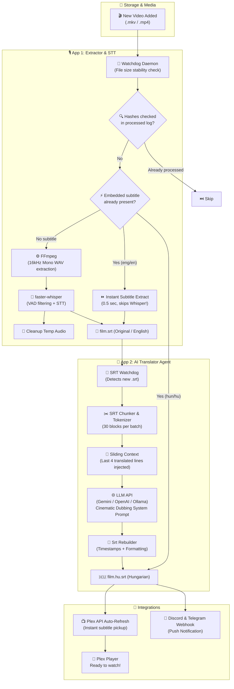

<div align="center">

# 🎬 Plex AI Subtitler
### Automated Voice-to-Subtitle STT & LLM Translation Pipeline for Plex Media Server

[](https://www.python.org/)
[](https://github.com/SYSTRAN/faster-whisper)
[](https://ai.google.dev/)
[](https://github.com/TomSchimansky/CustomTkinter)
[](#-windows-system-tray)
[](#-docker--nas-support-unraid-truenas-synology)
[](https://www.plex.tv/)
[](LICENSE)
[](https://github.com/Gyuri125/plex-ai-subtitler)

<br />

**[ 🇭🇺 Magyar nyelvű leíráshoz kattints ide ](#-magyar-dokumentáció-és-gyorsútmutató)** • **[ 🤖 Agent & Developer Guide ](AGENT_README.md)**

<br />

<p align="center">
  <b>Plex AI Subtitler</b> is a robust, production-grade automation daemon that monitors your media library, extracts existing embedded subtitles in seconds (or transcribes audio via <code>faster-whisper</code>), translates subtitles into natural, cinematic Hungarian using modern LLMs (Google Gemini, OpenAI, or local Ollama) with <b>Sliding Context</b>, triggers <b>Plex Auto-Refresh</b>, and sends push notifications to <b>Discord</b> or <b>Telegram</b>.
</p>

</div>

---

## 🌟 Key Highlights

<table>
  <tr>
    <td width="50%">
      <h3>⚡ Stage 1: Fast Extraction & Whisper STT</h3>
      <ul>
        <li><b>100× Fast Embedded Subtitle Extraction:</b> Automatically probes <code>.mkv</code>/<code>.mp4</code> containers for existing English (or Hungarian) subtitles. If found, extracts them in 0.5s and skips Whisper!</li>
        <li><b>Hardware Auto-Tuning Whisper:</b> If no subtitle is embedded, auto-detects CUDA/VRAM and transcribes with optimal model (<code>small</code>, <code>medium</code>, <code>large-v3</code>).</li>
        <li><b>File Stabilization:</b> Verifies torrents or copies are 100% finished before processing.</li>
        <li><b>Deduplication:</b> MD5-based fingerprint tracking in <code>processed_files.log</code> prevents re-processing.</li>
        <li><b>Zero Junk Files:</b> Automatically cleans up temporary WAV files.</li>
      </ul>
    </td>
    <td width="50%">
      <h3>🤖 Stage 2: AI Subtitle Translator</h3>
      <ul>
        <li><b>Sliding Context Window:</b> Feeds previous translated lines into the next chunk prompt, preserving continuous narrative tone, character gender, and pronoun consistency (tegezés/önözés).</li>
        <li><b>Cinematic Prompting:</b> Preserves tone, slang, character idioms, and colloquialisms for dubbing quality.</li>
        <li><b>Multi-Provider:</b> Native support for <b>Google Gemini</b> (Flash / Pro), <b>OpenAI</b> (GPT-4o-mini), and <b>Local Ollama</b> (Llama 3 / Mistral).</li>
        <li><b>Rate-Limit Protection:</b> Intelligent retry mechanism with exponential backoff and HTTP 429 quota waiting.</li>
      </ul>
    </td>
  </tr>
  <tr>
    <td width="50%">
      <h3>🎨 Modern Dark GUI & System Tray</h3>
      <ul>
        <li>Built with <b>CustomTkinter</b> Dark Mode.</li>
        <li><b>Windows System Tray:</b> Minimizes to tray on close, running smoothly in the background.</li>
        <li>Interactive model discovery directly querying available Gemini / OpenAI / Ollama models.</li>
        <li>Live thread-safe LogBox with real-time status updates.</li>
        <li>One-click manual file processing.</li>
      </ul>
    </td>
    <td width="50%">
      <h3>📺 Integrations & Push Notifications</h3>
      <ul>
        <li><b>Plex Auto-Refresh:</b> Calls the Plex API (<code>/library/sections/all/refresh</code>) as soon as the subtitle is ready so it appears in the player instantly!</li>
        <li><b>Discord & Telegram Alerts:</b> Receive instant push notifications on your phone with translation duration and block statistics.</li>
        <li><b>Sidecar Naming:</b> Generates <code>movie.srt</code> and <code>movie.hu.srt</code> for 100% native Plex compatibility.</li>
      </ul>
    </td>
  </tr>
</table>

---

## 🏗️ Architecture Pipeline



---

## 📁 Plex File Naming Convention

Plex Media Server automatically indexes subtitles that follow standard sidecar naming conventions:

```text
/Media/Movies/
├── Inception (2010).mkv
├── Inception (2010).srt          <-- Stage 1 Output (English / Source)
└── Inception (2010).hu.srt       <-- Stage 2 Output (Hungarian / AI Translated)
```

Both subtitles appear instantly in the Plex player's subtitle selector without library re-scans.

---

## ⚡ Hardware Auto-Tuning Matrix

The built-in `HardwareManager` scans your system's CUDA capabilities and configures `faster-whisper` for maximum speed without Out-Of-Memory (OOM) errors:

| Hardware Tier | Detected Hardware | Recommended Model | Device | Compute Type | Transcription Speed |
| :--- | :--- | :--- | :--- | :--- | :--- |
| **High GPU** | NVIDIA CUDA $\ge$ 8GB VRAM | `large-v3` | `cuda` | `float16` | ⚡⚡⚡⚡⚡ (~30x realtime) |
| **Mid GPU** | NVIDIA CUDA $\ge$ 4GB VRAM | `medium` | `cuda` | `float16` | ⚡⚡⚡⚡ (~20x realtime) |
| **Entry GPU** | NVIDIA CUDA $<$ 4GB VRAM | `small` | `cuda` | `float16` | ⚡⚡⚡ (~15x realtime) |
| **CPU Only** | Any Multi-core CPU | `small` | `cpu` | `int8` | ⚡⚡ (~3-5x realtime) |

---

## 🚀 Quick Start Guide

### 1. Prerequisites
- **Python 3.11+** installed
- **FFmpeg**:
  - **Windows**: `winget install ffmpeg` or download from [ffmpeg.org](https://ffmpeg.org/download.html)
  - **Linux (Ubuntu/Debian)**: `sudo apt install ffmpeg`
  - **macOS**: `brew install ffmpeg`
- *(Optional for GPU acceleration)*: **NVIDIA GPU + CUDA Drivers**

### 2. Clone & Install

```bash
# Clone the repository
git clone https://github.com/Gyuri125/plex-ai-subtitler.git
cd plex-ai-subtitler

# Create virtual environment
python -m venv .venv

# Activate virtual environment
# Windows (PowerShell):
.venv\Scripts\Activate.ps1
# Windows (cmd):
.venv\Scripts\activate.bat
# Linux/macOS:
source .venv/bin/activate

# Install dependencies
pip install -r requirements.txt
```

### 3. Launching

- **Double-click:** Run [`inditas.bat`](file:///inditas.bat) to launch the GUI instantly without opening a black command prompt.
- **Command Line:**
  ```bash
  python -m plex_subtitler.app1_extractor.main
  ```

---

## 🛠️ Automated Exe Compiler & Updater (`build_exe.bat`)

The repository includes a smart, one-click Windows build script: [`build_exe.bat`](file:///build_exe.bat).

**What it does automatically:**
1. Runs `git pull origin main` to pull the latest version from GitHub.
2. Updates and installs dependencies (`requirements.txt` and `pyinstaller`).
3. Closes any running instances of `PlexSubtitler.exe`.
4. Compiles the standalone executable via PyInstaller and overwrites the previous version.
5. Offers to launch the newly built app immediately!

To use it, simply **double-click `build_exe.bat`** in the project folder!

---

## 🐳 Docker & NAS Support (Unraid, TrueNAS, Synology)

Run headless on your home server or NAS with `docker-compose`:

```bash
# Start container
docker-compose up -d
```

Example `docker-compose.yml`:
```yaml
version: "3.8"
services:
  plex-subtitler:
    build: .
    container_name: plex-ai-subtitler
    restart: unless-stopped
    volumes:
      - /mnt/user/data/media:/media:rw
      - ./settings.json:/app/plex_subtitler/settings.json:rw
      - ./processed_files.log:/app/plex_subtitler/processed_files.log:rw
```

---

## 🇭🇺 Magyar Dokumentáció és Gyorsútmutató

### Főbb Új Funkciók:
1. **⚡ Beágyazott feliratok kinyerése (100×-os gyorsulás):**
   Ha az `.mkv` vagy `.mp4` videóban már létezik angol felirat, a program 0.5 másodperc alatt kinyeri és kihagyja a hosszú Whisper feldolgozást! Ha magyar felirat is van benne, azonnal elmenti és késznek nyilvánítja a filmet.
2. **🧠 Gördülő kontextus-ablak (Sliding Context):**
   Minden fordítási blokknál átadja az előző jelenet utolsó 3-4 mondatát, így az LLM pontosan tudja a szereplők nemét és tegezési/magázódási viszonyát.
3. **📡 Automatikus Plex Könyvtárfrissítés:**
   Amint elkészül a felirat, a program a Plex API-n keresztül azonnal frissíti a könyvtárat, így a felirat azonnal kattintható a tévén vagy mobilon.
4. **📌 Rendszertálca (System Tray):**
   A program a jobb felső "X" gombbal a Windows óra mellé rejthető, és a háttérben figyeli a mappákat.
5. **🔔 Discord és Telegram Értesítések:**
   Push üzenetet kapsz a telefonodra, amikor elkészül egy új film magyar felirata.
6. **🛠️ Egykattintásos Exe Frissítő (`build_exe.bat`):**
   Automatikusan letölti a legújabb verziót a GitHubról és lefordítja az új exe-t felülírva a régit!

---

## 📄 License

Distributed under the **MIT License**. See [`LICENSE`](LICENSE) for more information.

<div align="center">
  <sub>Created with ❤️ for Plex & Home Theater enthusiasts by <a href="https://github.com/Gyuri125">Gyuri125</a>.</sub>
</div>
