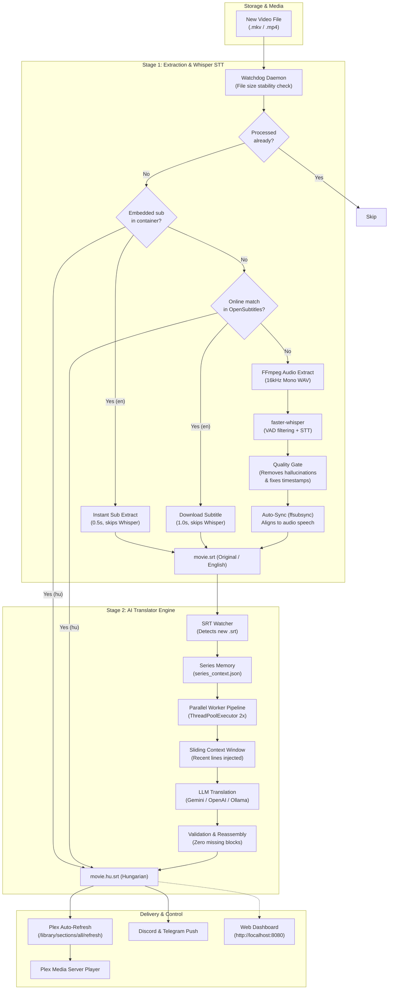

<div align="center">

# Plex AI Subtitler
### Automated Speech-to-Text and LLM Translation Pipeline for Plex Media Server

[](https://www.python.org/)
[](https://github.com/SYSTRAN/faster-whisper)
[](https://ai.google.dev/)
[](https://github.com/TomSchimansky/CustomTkinter)
[](#built-in-web-dashboard)
[](#desktop-gui--system-tray)
[](#docker-and-nas-support)
[](https://www.plex.tv/)
[](LICENSE)
[](https://github.com/Gyuri125/plex-ai-subtitler)

<br />

**[English Documentation](#architecture-pipeline)** | **[Magyar Nyelvű Dokumentáció](#magyar-dokumentacio-es-hasznalati-utmutato)** | **[Agent & Developer Guide](AGENT_README.md)**

<br />

<p align="center">
  <b>Plex AI Subtitler</b> is an end-to-end automated pipeline that monitors your media library, instantly extracts embedded subtitles, queries online subtitle repositories by exact 64-bit release hash, transcribes speech with <code>faster-whisper</code>, removes hallucinations via Quality Gate, synchronizes timing with <code>ffsubsync</code>, translates into natural Hungarian using LLMs with sliding context and series memory across parallel worker threads, refreshes Plex instantly, and exposes a real-time Web Dashboard.
</p>

</div>

---

## Table of Contents

- [Key Architecture Features](#key-architecture-features)
- [Performance & Pipeline Comparison](#performance--pipeline-comparison)
- [Architecture Pipeline](#architecture-pipeline)
- [Plex File Naming Convention](#plex-file-naming-convention)
- [Hardware Auto-Tuning Matrix](#hardware-auto-tuning-matrix)
- [Built-in Web Dashboard](#built-in-web-dashboard)
- [Series Memory & Character Glossary](#series-memory--character-glossary)
- [Installation & Quick Start](#installation--quick-start)
- [Standalone Executable Build & Auto-Updater](#standalone-executable-build--auto-updater)
- [Docker and NAS Support](#docker-and-nas-support)
- [Configuration Reference](#configuration-reference)
- [Magyar Dokumentacio es Hasznalati Utmutato](#magyar-dokumentacio-es-hasznalati-utmutato)
- [License](#license)

---

## Key Architecture Features

<table>
  <tr>
    <td width="50%">
      <h3>Stage 1: Discovery, Extraction & STT</h3>
      <ul>
        <li><b>Embedded Subtitle Fast-Extraction:</b> Probes <code>.mkv</code> and <code>.mp4</code> containers for existing subtitles. If found, extracts them in under a second and skips Whisper completely.</li>
        <li><b>Online Subtitle Downloader (OpenSubtitles):</b> Calculates 64-bit OSdb moviehash and clean release title to fetch exact-match subtitles prior to running local transcription.</li>
        <li><b>Quality Gate & Hallucination Filter:</b> Automatically removes Whisper phantom patterns (<i>"Thank you for watching"</i>, <i>"Please subscribe"</i>, music symbols) and repairs timestamp overlaps.</li>
        <li><b>Auto-Sync (ffsubsync):</b> Aligns subtitle timestamps to actual speech detected in the audio track for millisecond-level precision.</li>
        <li><b>Hardware Auto-Tuning:</b> Automatically inspects CUDA/VRAM and configures the optimal Whisper model.</li>
      </ul>
    </td>
    <td width="50%">
      <h3>Stage 2: AI Subtitle Translation</h3>
      <ul>
        <li><b>Sliding Context Window:</b> Injects preceding dialogue into subsequent chunk prompts, preserving continuous tone, gender, and pronoun consistency.</li>
        <li><b>Series Memory & Character Glossary:</b> Automatically creates and updates <code>series_context.json</code> across episodes to enforce uniform terminology and address forms.</li>
        <li><b>Parallel Worker Pipeline:</b> Concurrently processes chunk partitions across multiple threads, cutting total translation time in half.</li>
        <li><b>Multi-Provider:</b> Native support for Google Gemini (Flash / Pro), OpenAI (GPT-4o-mini), and local Ollama (Llama 3 / Mistral).</li>
        <li><b>Rate-Limit Protection:</b> Intelligent retry mechanism with exponential backoff and quota recovery.</li>
      </ul>
    </td>
  </tr>
  <tr>
    <td width="50%">
      <h3>Control Interfaces</h3>
      <ul>
        <li><b>CustomTkinter Desktop GUI:</b> Modern dark-themed interface with real-time logs and setting management.</li>
        <li><b>Built-in Web Dashboard:</b> Access, monitor, and configure the application from any web browser or mobile device on headless/NAS servers (port 8080).</li>
        <li><b>Windows System Tray:</b> Minimizes to the taskbar notification area and continues running in the background.</li>
        <li><b>Dynamic Model Discovery:</b> Direct querying of available models from Google, OpenAI, or Ollama.</li>
      </ul>
    </td>
    <td width="50%">
      <h3>Integrations & Notifications</h3>
      <ul>
        <li><b>Plex Auto-Refresh:</b> Calls the Plex API (<code>/library/sections/all/refresh</code>) as soon as the subtitle is ready so it appears in the player immediately.</li>
        <li><b>Discord & Telegram Alerts:</b> Receive push notifications with translation duration and block statistics.</li>
        <li><b>Sidecar Naming:</b> Generates <code>movie.srt</code> and <code>movie.hu.srt</code> for 100% native Plex compatibility.</li>
      </ul>
    </td>
  </tr>
</table>

---

## Performance & Pipeline Comparison

| Processing Mode | Step 1 (Audio / Text) | Step 2 (Translation) | Total Time for 2h Movie | CPU / GPU Load |
| :--- | :--- | :--- | :--- | :--- |
| **A. Embedded Subtitle Path** | Instant container extract (0.5s) | Parallel LLM translation | **~35 seconds** | Near zero |
| **B. Online Hash-Match Path** | OpenSubtitles API download (1.0s) | Parallel LLM translation | **~36 seconds** | Near zero |
| **C. Whisper STT + Parallel LLM** | faster-whisper STT (~3-8 min) | Parallel LLM translation | **~4-9 minutes** | Moderate (GPU/CPU) |
| *Previous Sequential Baseline* | faster-whisper STT (~10-15 min) | Sequential single-thread LLM | ~13-18 minutes | Heavy |

---

## Architecture Pipeline



---

## Plex File Naming Convention

Plex Media Server automatically indexes subtitles that follow standard sidecar naming conventions:

```text
/Media/Movies/
|-- Inception (2010).mkv
|-- Inception (2010).srt          <-- Stage 1 Output (English / Source)
`-- Inception (2010).hu.srt       <-- Stage 2 Output (Hungarian / AI Translated)
```

Both subtitles appear in the Plex player subtitle selector without requiring library re-scans.

---

## Hardware Auto-Tuning Matrix

The built-in `HardwareManager` scans system CUDA capabilities and configures `faster-whisper` for maximum throughput without Out-Of-Memory (OOM) errors:

| Hardware Tier | Detected Hardware | Recommended Model | Device | Compute Type | Transcription Speed |
| :--- | :--- | :--- | :--- | :--- | :--- |
| **High GPU** | NVIDIA CUDA >= 8GB VRAM | `large-v3` | `cuda` | `float16` | ~30x realtime |
| **Mid GPU** | NVIDIA CUDA >= 4GB VRAM | `medium` | `cuda` | `float16` | ~20x realtime |
| **Entry GPU** | NVIDIA CUDA < 4GB VRAM | `small` | `cuda` | `float16` | ~15x realtime |
| **CPU Only** | Multi-core CPU | `small` | `cpu` | `int8` | ~3-5x realtime |

---

## Built-in Web Dashboard

For headless servers and NAS devices, Plex AI Subtitler includes a lightweight built-in web server with zero external web dependencies:

- **Web Dashboard URL:** `http://localhost:8080` (or your server's LAN IP).
- **Features:** Real-time status cards, processed file counters, active directory settings, live log viewer, and configuration editing.
- **REST API Endpoints:**
  - `GET /api/status`: Returns current engine state, active models, hardware configuration, and statistics.
  - `GET /api/logs`: Returns recent log entries from the pipeline.
  - `POST /api/config`: Updates settings remotely from any web browser or curl command.
- **CLI Activation:** Run with `--web` or standalone via `python -m plex_subtitler.web`.

---

## Series Memory & Character Glossary

For television series, the translator automatically detects episode structures (e.g. `S01E05` or `1x05`) and manages a persistent `series_context.json` file in the show's directory:

```json
{
  "series_title": "Severance",
  "characters": {
    "Mark": "tegez",
    "Cobel": "magaz"
  },
  "terms": {
    "Macrodata Refinement": "Makroadat Finomitas",
    "Innie": "Benti",
    "Outie": "Kinti"
  },
  "notes": "Hasznalj feszes, termeszetes szinkronhangnemet."
}
```

This context is injected into every translation prompt, ensuring consistent address forms and terminology across the entire season.

---

## Installation & Quick Start

### 1. Prerequisites
- Python 3.11+
- FFmpeg (Windows: `winget install ffmpeg`, Linux: `sudo apt install ffmpeg`, macOS: `brew install ffmpeg`)
- Optional: NVIDIA GPU with CUDA drivers
- Optional: `ffsubsync` for automatic audio subtitle alignment (`pip install ffsubsync`)

### 2. Clone & Setup

```bash
git clone https://github.com/Gyuri125/plex-ai-subtitler.git
cd plex-ai-subtitler

python -m venv .venv

# Windows (PowerShell):
.venv\Scripts\Activate.ps1
# Windows (cmd):
.venv\Scripts\activate.bat
# Linux/macOS:
source .venv/bin/activate

pip install -r requirements.txt
```

### 3. Launching

- **Windows Shortcut:** Double-click `inditas.bat` to launch the GUI without an open console window.
- **Desktop GUI:**
  ```bash
  python -m plex_subtitler.app1_extractor.main
  ```
- **Headless / NAS Server Mode (with Web UI):**
  ```bash
  python -m plex_subtitler.app1_extractor.main --cli --web --scan-existing
  ```
- **Single File Test:**
  ```bash
  python -m plex_subtitler.app1_extractor.main --once "C:/Media/Movies/Sample.mkv"
  ```

---

## Standalone Executable Build & Auto-Updater

The repository includes an automated Windows build script: `build_exe.bat`.

Features:
1. Executes `git pull origin main` to pull latest updates from GitHub.
2. Updates dependencies and PyInstaller in the local virtual environment.
3. Closes running instances of `PlexSubtitler.exe` to avoid file locks.
4. Compiles the executable into `dist/PlexSubtitler/PlexSubtitler.exe`.
5. Prompts to launch the updated application immediately.

---

## Docker and NAS Support

Run headless on home servers or NAS devices (Unraid, TrueNAS, Synology) via `docker-compose`:

```bash
docker-compose up -d
```

Example `docker-compose.yml`:
```yaml
version: "3.8"
services:
  plex-subtitler:
    build: .
    container_name: plex-ai-subtitler
    restart: unless-stopped
    ports:
      - "8080:8080"
    volumes:
      - /path/to/media:/media:rw
      - ./settings.json:/app/plex_subtitler/settings.json:rw
      - ./processed_files.log:/app/plex_subtitler/processed_files.log:rw
```

---

## Configuration Reference

Settings are stored in `plex_subtitler/settings.json` and are fully manageable via GUI, Web Dashboard, or JSON:

| Setting Key | Type | Default | Description |
| :--- | :--- | :--- | :--- |
| `app1.watch_dirs` | `list[str]` | `[]` | Monitored directories for incoming video files. |
| `app1.extract_embedded_subs` | `bool` | `true` | Fast extraction of subtitles embedded in MKV/MP4 files. |
| `app1.download_online_subtitles` | `bool` | `true` | Queries OpenSubtitles by 64-bit release hash and title. |
| `app1.auto_sync_subtitles` | `bool` | `false` | Aligns subtitles to audio speech using `ffsubsync`. |
| `app1.quality_gate_enabled` | `bool` | `true` | Filters Whisper phantom hallucinations and repairs timestamps. |
| `app1.web_dashboard_enabled` | `bool` | `false` | Enables built-in Web Dashboard on startup. |
| `app1.web_dashboard_port` | `int` | `8080` | Port for the Web Dashboard interface. |
| `app2.llm_provider` | `str` | `"google"` | Translation provider (`"google"`, `"openai"`, `"ollama"`). |
| `app2.llm_model` | `str` | `"gemini-1.5-flash"` | Target LLM model name. |
| `app2.use_sliding_context` | `bool` | `true` | Feeds recent lines into subsequent chunk prompts. |
| `app2.series_memory_enabled` | `bool` | `true` | Manages `series_context.json` character glossaries. |
| `app2.parallel_translation_workers` | `int` | `2` | Number of concurrent LLM translation worker threads. |
| `app2.plex_auto_refresh` | `bool` | `false` | Calls Plex API to refresh libraries upon completion. |

---

## Magyar Dokumentacio es Hasznalati Utmutato

### A rendszer fo komponensei es mukodese:

1. **Beagyazott feliratok kinyerese (100x gyorsulas):**
   Ha az `.mkv` vagy `.mp4` videoban mar van angol vagy magyar feliratsav, a program 0.5 masodperc alatt kinyeri, es teljesen kihagyja a gepigenyes Whispert.
2. **Online feliratletoltes (OpenSubtitles):**
   A videofajl 64-bites OSdb hash-e alapjan ellenorzi az online felirat-adatbazisokat. Ha talal kesz magyar feliratot, a forditas is kihagyhato; ha angolt talal, azonnal mehet a forditohoz a Whisper STT kihagyasaval.
3. **Quality Gate es Whisper hallucinacio-szures:**
   Automatikusan eltavolitja az ismert fantomszovegeket (*"Thank you for watching"*, *"Please subscribe"*, zenei jelek, ismetlesi hurkok), javitja az atfedo idobelyegeket, es potolja az esetlegesen kimaradt feliratsorokat.
4. **Auto-Sync idozites-szinkronizalas (`ffsubsync`):**
   A felirat idobelyegeit millimasodperc-pontossaggal a video valodi beszedhangjahoz igazitja.
5. **Gordulo kontextus-ablak (Sliding Context):**
   A blokkok elott atadja az elozo jelenet sorait, biztositva a szinkron-stilusos tegezes/onozes es a karakterek nemenek folytonossagat.
6. **Sorozat-memoria es karakter-szotar (`series_context.json`):**
   Sorozatoknal automatikusan rogziti a foszereplok viszonyat es a szakkifejezeseket, igy az egesz evad nyelvezete egyseges marad.
7. **Parhuzamositott forditas (Pipeline Throughput):**
   Tobb concorrent szalon parhuzamosan kommunikal az LLM-mel, felezve a forditas idotartamat.
8. **Beepitett Web Dashboard:**
   Monitor nelkuli szervereken vagy NAS eszkozokon (port 8080) keresztul bongeszobol es mobilrol is kovetheto a folyamat.
9. **Plex konyvtarfrissites es Push ertesitesek:**
   Azonnali frissites a Plex API-n keresztul, valamint Discord es Telegram uzenetek.
10. **Rendszertalca (System Tray) es Automata build script (`build_exe.bat`):**
    Talcara rejtes es egykattintasos PyInstaller fordito.

---

## License

Distributed under the MIT License. See [LICENSE](LICENSE) for details.
