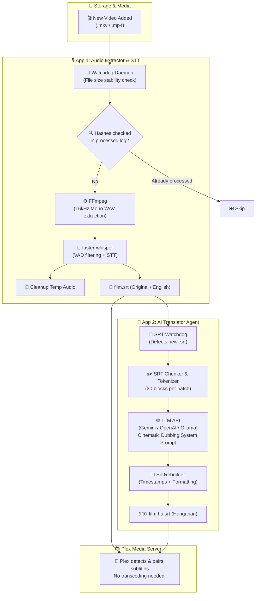

<div align="center">

# 🎬 Plex AI Subtitler
### Automated Voice-to-Subtitle STT & LLM Translation Pipeline for Plex Media Server

[](https://www.python.org/)
[](https://github.com/SYSTRAN/faster-whisper)
[](https://ai.google.dev/)
[](https://github.com/TomSchimansky/CustomTkinter)
[](https://www.plex.tv/)
[](LICENSE)
[](https://github.com/Gyuri125/plex-ai-subtitler)

<br />

**[ 🇭🇺 Magyar nyelvű leíráshoz kattints ide ](#-magyar-dokumentáció-és-gyorsútmutató)** • **[ 🤖 Agent & Developer Guide ](AGENT_README.md)**

<br />

<p align="center">
  <b>Plex AI Subtitler</b> is a robust, production-grade automation daemon that monitors your media library, extracts audio from videos using FFmpeg, generates high-accuracy timestamps via <code>faster-whisper</code>, and translates subtitles into natural, cinematic Hungarian using modern LLMs (Google Gemini, OpenAI, or local Ollama).
</p>

</div>

---

## 🌟 Key Highlights

<table>
  <tr>
    <td width="50%">
      <h3>🎙️ Stage 1: Audio Extractor & Whisper STT</h3>
      <ul>
        <li><b>Folder Watchdog:</b> Monitors movie and TV folders continuously.</li>
        <li><b>File Stabilization:</b> Verifies torrents or copies are 100% finished before processing.</li>
        <li><b>Hardware Auto-Tuning:</b> Automatically detects NVIDIA CUDA / VRAM and selects optimal Whisper model (<code>small</code>, <code>medium</code>, <code>large-v3</code>).</li>
        <li><b>Deduplication:</b> MD5-based fingerprint tracking in <code>processed_files.log</code> prevents re-processing.</li>
        <li><b>Zero Junk Files:</b> Automatically cleans up temporary WAV files after transcription.</li>
      </ul>
    </td>
    <td width="50%">
      <h3>🤖 Stage 2: AI Subtitle Translator</h3>
      <ul>
        <li><b>Cinematic Prompting:</b> Preserves tone, slang, character idioms, and colloquialisms for dubbing quality.</li>
        <li><b>Multi-Provider:</b> Native support for <b>Google Gemini</b> (Flash / Pro), <b>OpenAI</b> (GPT-4o-mini), and <b>Local Ollama</b> (Llama 3 / Mistral).</li>
        <li><b>Resilient Batching:</b> Chunking engine preserves SRT indices, timestamps, and line breaks without drift.</li>
        <li><b>Rate-Limit Protection:</b> Intelligent retry mechanism with exponential backoff and HTTP 429 quota waiting.</li>
        <li><b>Partial Progress Saving:</b> Never lose translated blocks on unexpected shutdowns.</li>
      </ul>
    </td>
  </tr>
  <tr>
    <td width="50%">
      <h3>🎨 Modern Dark-Mode GUI</h3>
      <ul>
        <li>Built with <b>CustomTkinter</b> for a sleek, responsive experience.</li>
        <li>One-click Hardware Optimization & Auto-Profile fallback.</li>
        <li>Live thread-safe LogBox with real-time status updates.</li>
        <li>Manual one-file extraction and translation testing.</li>
        <li>Interactive model discovery directly querying available Gemini / OpenAI / Ollama models.</li>
      </ul>
    </td>
    <td width="50%">
      <h3>📺 100% Plex Server Integration</h3>
      <ul>
        <li>Outputs sidecar <code>.srt</code> files directly next to video files.</li>
        <li>Generates primary audio subtitle (<code>movie.srt</code> / <code>movie.en.srt</code>).</li>
        <li>Generates localized target subtitle (<code>movie.hu.srt</code>).</li>
        <li><b>Zero Plex plugins required:</b> Plex Media Server instantly and natively detects external subtitles.</li>
      </ul>
    </td>
  </tr>
</table>

---

## 🏗️ Architecture Pipeline



---

## 📁 Plex File Naming Convention

Plex Media Server automatically indexes subtitles that follow standard sidecar naming conventions:

```text
/Media/Movies/
├── Inception (2010).mkv
├── Inception (2010).srt          <-- Stage 1 Output (English / Source)
└── Inception (2010).hu.srt       <-- Stage 2 Output (Hungarian / AI Translated)
```

Both subtitles appear instantly in the Plex player's subtitle selector without library re-scans.

---

## ⚡ Hardware Auto-Tuning Matrix

The built-in `HardwareManager` scans your system's CUDA capabilities and configures `faster-whisper` for maximum speed without Out-Of-Memory (OOM) errors:

| Hardware Tier | Detected Hardware | Recommended Model | Device | Compute Type | Transcription Speed |
| :--- | :--- | :--- | :--- | :--- | :--- |
| **High GPU** | NVIDIA CUDA $\ge$ 8GB VRAM | `large-v3` | `cuda` | `float16` | ⚡⚡⚡⚡⚡ (~30x realtime) |
| **Mid GPU** | NVIDIA CUDA $\ge$ 4GB VRAM | `medium` | `cuda` | `float16` | ⚡⚡⚡⚡ (~20x realtime) |
| **Entry GPU** | NVIDIA CUDA $<$ 4GB VRAM | `small` | `cuda` | `float16` | ⚡⚡⚡ (~15x realtime) |
| **CPU Only** | Any Multi-core CPU | `small` | `cpu` | `int8` | ⚡⚡ (~3-5x realtime) |

---

## 🚀 Quick Start Guide

### 1. Prerequisites
- **Python 3.11+** installed
- **FFmpeg**:
  - **Windows**: `winget install ffmpeg` or download from [ffmpeg.org](https://ffmpeg.org/download.html)
  - **Linux (Ubuntu/Debian)**: `sudo apt install ffmpeg`
  - **macOS**: `brew install ffmpeg`
- *(Optional for GPU acceleration)*: **NVIDIA GPU + CUDA Drivers**

### 2. Clone & Install

```bash
# Clone the repository
git clone https://github.com/Gyuri125/plex-ai-subtitler.git
cd plex-ai-subtitler

# Create virtual environment
python -m venv .venv

# Activate virtual environment
# Windows (PowerShell):
.venv\Scripts\Activate.ps1
# Windows (cmd):
.venv\Scripts\activate.bat
# Linux/macOS:
source .venv/bin/activate

# Install dependencies
pip install -r requirements.txt
```

> **Tip for NVIDIA GPU users:** If you have CUDA installed, enable GPU Whisper acceleration via:
> ```bash
> pip install torch --index-url https://download.pytorch.org/whl/cu121
> ```

### 3. Configuration

Copy the example configuration file:

```bash
# Windows
copy settings.json.example plex_subtitler\settings.json

# Linux / macOS
cp settings.json.example plex_subtitler/settings.json
```

Edit `plex_subtitler/settings.json` or configure everything visually in the GUI:

```json
{
    "app1": {
        "watch_dirs": [
            "D:/Media/Movies",
            "D:/Media/TV Shows"
        ],
        "temp_audio_dir": "./temp_audio",
        "ffmpeg_path": "ffmpeg",
        "whisper_model": "small",
        "whisper_device": "cpu",
        "whisper_compute_type": "int8"
    },
    "app2": {
        "llm_provider": "google",
        "llm_api_key": "YOUR_GEMINI_API_KEY",
        "llm_model": "gemini-1.5-flash",
        "target_language": "Hungarian",
        "translation_batch_size": 30
    }
}
```

---

## 🖥️ Usage

### Option A: Launch GUI (Default)

```bash
python -m plex_subtitler.app1_extractor.main
```

- Click **"Hardver vizsgálata & Auto profil"** to detect CUDA and auto-tune Whisper.
- Set your watched media directory.
- Enter your Gemini or OpenAI API Key (or select Ollama for 100% free local translation).
- Click **"Mappafigyelő Indítása"** to start the continuous background daemon.

### Option B: Headless / CLI Daemon (Servers / NAS)

Ideal for Docker, Unraid, TrueNAS, or headless Linux/Windows servers:

```bash
# Run continuous watcher daemon
python -m plex_subtitler.app1_extractor.main --cli

# Scan existing unprocessed files on start
python -m plex_subtitler.app1_extractor.main --cli --scan-existing

# Process a single movie file and exit (Test mode)
python -m plex_subtitler.app1_extractor.main --once "C:/Media/Movies/Sample.mkv"
```

---

## 🤖 Supported LLM Providers

| Provider | Recommended Model | Speed | Cost | Notes |
| :--- | :--- | :--- | :--- | :--- |
| **Google Gemini** *(Recommended)* | `gemini-1.5-flash` / `gemini-2.0-flash` | Ultra-Fast | Free tier / Extremely Cheap | Exceptional Hungarian dubbing context, high rate limits. |
| **OpenAI** | `gpt-4o-mini` | Very Fast | Low | High fidelity, great translation consistency. |
| **Ollama (Local)** | `llama3:8b`, `mistral`, `qwen2.5` | Fast (GPU) | **100% Free** | Runs entirely offline on your local hardware. |

---

## 📦 Standalone Windows Executable (.exe)

You can build a standalone, one-click Windows executable with PyInstaller:

```bash
pip install pyinstaller
pyinstaller PlexSubtitler.spec
```

The output executable will be created in `dist/PlexSubtitler/PlexSubtitler.exe`.

---

## 🇭🇺 Magyar Dokumentáció és Gyorsútmutató

### Mi ez a projekt?
A **Plex AI Subtitler** egy kétszintű, teljesen automatizált felirat-előállító és fordító rendszer:
1. **1. Fázis (Extractor & STT):** Folyamatosan figyeli a Plex film- és sorozat-mappáit. Amikor új videó érkezik, az FFmpeg segítségével kinyeri a hangsávot, a `faster-whisper` neurális hálóval feliratot generál eredeti nyelven (angol `.srt`), majd azonnal törli az ideiglenes hangfájlt.
2. **2. Fázis (AI Translator):** Észleli az új `.srt` fájlokat, 30 blokkos csomagokra bontja azokat, és mesterséges intelligenciával (Google Gemini, OpenAI vagy lokális Ollama) természetes hangzású, szinkron-stílusú magyar felirattá (`.hu.srt`) fordítja.
3. **Plex Kész Eredmény:** A Plex Media Server automatikusan, átkódolás nélkül felismeri és megjeleníti a feliratokat.

### Gyors beüzemelés:
1. Klónozd a tárat: `git clone https://github.com/Gyuri125/plex-ai-subtitler.git`
2. Virtuális környezet és függőségek:
   ```bash
   python -m venv .venv
   .venv\Scripts\activate
   pip install -r requirements.txt
   ```
3. Indítás:
   ```bash
   python -m plex_subtitler.app1_extractor.main
   ```
4. A grafikus felületen add meg a figyelendő mappát, az API kulcsodat (pl. Google Gemini Flash), kattints az automatikus hardverbeállításra, majd nyomd meg a **"Mappafigyelő Indítása"** gombot.

További mélyreható fejlesztői és architektúrális részletekért olvasd el az **[AGENT_README.md](AGENT_README.md)** fájlt!

---

## 🔒 Security & Privacy

- **Never Commit Secrets:** `settings.json`, `.env`, és minden API kulcs alapértelmezetten szerepel a `.gitignore`-ban.
- **Local Data Only:** A médiafájlok és ideiglenes audiók soha nem hagyják el a gépedet. Csak a szöveges feliratsorok kerülnek továbbításra a választott fordító API felé (vagy ha Ollamát használsz, még azok sem).

---

## 🤝 Contributing

Contributions, bug reports, and feature requests are welcome!
1. Fork the repository
2. Create your feature branch (`git checkout -b feature/amazing-feature`)
3. Commit your changes (`git commit -m 'Add amazing feature'`)
4. Push to the branch (`git push origin feature/amazing-feature`)
5. Open a Pull Request

---

## 📄 License

Distributed under the **MIT License**. See [`LICENSE`](LICENSE) for more information.

<div align="center">
  <sub>Created with ❤️ for Plex & Home Theater enthusiasts by <a href="https://github.com/Gyuri125">Gyuri125</a>.</sub>
</div>
