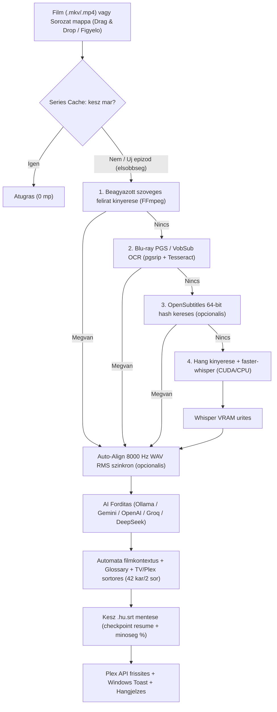

<div align="center">

# Plex AI Subtitler

### Automated Subtitle Extraction, Speech-to-Text, Audio Sync, and LLM Translation Engine for Plex Media Server

[](https://github.com/Gyuri125/plex-ai-subtitler/releases)
[](https://www.python.org/)
[](https://github.com/SYSTRAN/faster-whisper)
[](#ai-forditas-es-kontextus-megorzes)
[](#felhasznaloi-felulet-egyszeru-es-halado-nezet)
[](#docker-es-nas-futtatas)
[](LICENSE)

**[English Overview](#english-overview)** | **[Magyar Dokumentacio](#magyar-dokumentacio)** | **[Ultimate Installer](#ultimate-telepito-es-elozetes-hardverfelmeres)** | **[CLI Reference](#parancssori-hasznalat-cli)**

</div>

---

## English Overview

**Plex AI Subtitler** is a production-ready, fault-tolerant subtitle pipeline built for **Plex Media Server** (Windows desktop with native Drag & Drop GUI and headless CLI/Docker for home servers).

### Core Capabilities

- **4-Step Smart Subtitle Source Pipeline:**
  1. Instant text subtitle extraction from MKV/MP4 containers (`subrip`, `ass`, `mov_text`, `webvtt`) via FFmpeg.
  2. Optional Blu-ray PGS (`hdmv_pgs_subtitle`) / DVD VobSub image subtitle OCR (`pgsrip` + Tesseract OCR).
  3. Optional OpenSubtitles API lookup by exact 64-bit OpenSubtitles release hash.
  4. `faster-whisper` GPU/CPU speech-to-text transcription with automatic commentary-track avoidance and VRAM unloading before local LLM inference.
- **Context-Aware LLM Translation & TV/Plex Formatting:**
  - Supports **100% local Ollama** (auto-starts `ollama serve`, auto-pulls missing models, dynamic `keep_alive`) as well as **Google Gemini, OpenAI, Groq, DeepSeek, and OpenRouter**.
  - Automatic rolling movie-context prompt injection, custom character Glossary, checkpointed crash-safe resume (`.part` recovery), automatic targeted repair pass for accidentally untranslated lines, TV/Plex 42-char / 2-line wrapping, overlap fixing, and quality metrics (`%`).
- **Real Audio-to-Subtitle Sync Verification & Auto-Align:**
  - Measures true 8000 Hz WAV speech energy (RMS, vectorized with NumPy) against SRT timestamps and automatically corrects uniform drift within `+-3000 ms`.
- **Upfront Hardware Profiling & Ultimate Windows Installer:**
  - `TELEPITO_ULTIMATE.bat` + `setup_ultimate.ps1` survey OS, CPU, RAM, NVIDIA GPU/VRAM/driver, and free disk space before installation, select the optimal tier (`CUDA_ULTRA`, `CUDA_MID`, `CUDA_ENTRY`, `CPU_ONLY`), pre-install all dependencies (VC++ Redistributable, Python 3.12, FFmpeg, Tesseract OCR, Ollama + model, `uv`, PyTorch, PyInstaller), run tests, build `PlexSubtitler.exe`, and write full installation logs.
- **Resilient Diagnostics & Logging:**
  - Short error codes (`ERR-OLLAMA-01` .. `ERR-GEN-99`), 1-click self-healing fixes in the error dialog, live GPU/AI/FFmpeg/Plex health bar, built-in History & Resume window, 1-click secret-redacted diagnostic `.zip` export, 3-tier writable log-directory fallback, `faulthandler` native crash logging, Tkinter callback crash capture, and atomic `settings.json` saves.
- **Plex & Gaming Awareness:**
  - Native Plex Media Server library refresh API (`X-Plex-Token`), Windows Toast notifications, fullscreen Direct3D/Vulkan game pause guard (`SHQueryUserNotificationState`), and optional Windows Task Scheduler logon watcher.

---

## Magyar Dokumentacio

A **Plex AI Subtitler (v1.3.0)** egy teljes koru, helyi vagy felhos AI-alapu felirat-kinyero, hangfelismero (Whisper), szinkron-ellenorzo es filmfelirat-fordito rendszer Plex Media Serverhez.

### Mukodesi folyamat



---

## Ultimate Telepito es Elozetes Hardverfelmeres

A gyokermappaban talalhato [TELEPITO_ULTIMATE.bat](TELEPITO_ULTIMATE.bat) dupla kattintassal indithato Windows 10/11 alatt. PowerShell vegrehajtasi korlatozas nelkul (`-ExecutionPolicy Bypass`) futtatja a [setup_ultimate.ps1](setup_ultimate.ps1) telepitot, es mar az inditaskor kulon indito naplot ir (`logs/install_bat_YYYYMMDD_HHMMSS.log`).

### 0. lepes: Automatikus hardverprofil-valasztas

A telepito minden letoltes elott felmeri a gepet (OS, CPU magszam, teljes es szabad RAM, NVIDIA GPU / VRAM / driver `nvidia-smi`-vel, szabad tarhely), elmenti a `logs/hardware_report.json` riportot, es automatikusan kivalasztja a hardverhez illo profilt:

| Hardverprofil | Detektalt feltetel | PyTorch | Whisper profil | Lokalis Ollama modell | Blokkméret |
| :--- | :--- | :--- | :--- | :--- | :--- |
| `CUDA_ULTRA` | NVIDIA GPU `>= 11 GB` VRAM (pl. RTX 3080 12 GB, 3090, 4080, 4090) | `cu124` + cuBLAS/cuDNN | `large-v3` (`cuda` / `float16`) | `gemma3:12b` | `12` |
| `CUDA_MID` | NVIDIA GPU `7.5 - 10.9 GB` VRAM (pl. RTX 3060 Ti, 3070, 4060) | `cu124` + cuBLAS/cuDNN | `large-v3` (`cuda` / `float16`) | `gemma3:4b` | `10` |
| `CUDA_ENTRY` | NVIDIA GPU `4.0 - 7.4 GB` VRAM (pl. RTX 3050, GTX 1660) | `cu124` + cuBLAS/cuDNN | `medium` (`cuda` / `float16`) | `gemma3:4b` | `8` |
| `CPU_ONLY` | Nincs CUDA GPU vagy `< 4 GB` VRAM | CPU (kisebb meret) | `small` (`cpu` / `int8`) | `gemma3:4b` (`>= 12 GB` RAM) / `gemma3:1b` | `6` |

### Mit telepit elo automatikusan az Ultimate Telepito?

1. **Microsoft Visual C++ Redistributable (x64)** — a PyTorch es CTranslate2 nativ DLL-ekhez.
2. **Python 3.12** — ha hianyzik vagy regebbi, automatikusan telepiti (`winget` vagy hivatalos python.org telepito).
3. **FFmpeg + ffprobe** — rendszerszintu telepites (`winget`, fallbackkent a beepitett `imageio-ffmpeg` is elerheto).
4. **Tesseract OCR** — Blu-ray PGS kepfeliratok szovegge alakitasahoz, PATH-ba regisztralva.
5. **Ollama + hardverhez illo AI modell** — telepiti, elinditja a hatterben, es lehuzza a kivalasztott modellt.
6. **`uv` + `.venv` + PyTorch (CUDA/CPU) + `requirements.txt` + PyInstaller** — teljes fuggoseg-import ellenorzessel.
7. **Hardverhez igazitott `settings.json`** — korabbi beallitasok biztonsagi mentesevel (`.pre_install.bak`).
8. **Automata `pytest` + `doctor_gpu.py --live-llm`** — teljes onellenorzes es elo AI probaforditas.
9. **`PlexSubtitler.exe` build + Asztali parancsikonok** — `Film feliratozas (Huzd ide).lnk` (`--quick`) es `Plex Subtitler.lnk`, opcionalisan Windows Task Scheduler hatterfigyelo (`-EnableAutostart`).

Telepites kozben es vegen reszletes osszegzo tablazat keszul a `logs/install_ultimate_YYYYMMDD_HHMMSS.log` fajlba.

---

## Felhasznaloi Felulet (Egyszeru es Halado Nezet)

- **Egyszeru nezet & 1-Click Gyors mod (`--quick`):**
  - Nativ Drag & Drop: egyetlen film (`.mkv`, `.mp4`, `.avi`, `.mov`, `.m4v`, `.ts`), tobb epizod vagy teljes sorozat-mappa behuzhato kozvetlenul az ablakba.
  - **Sorozat-cache (`series_cache.json`) es elsobbsegi varolista:** a mar kesz epizodokat 0 masodperc alatt atugorja, a kesobb bemasolt uj epizodok pedig a varolista elejere kerulnek.
  - **Elo rendszer-allapotjelzo sav (`HealthStatusBar`):** indulaskor nem-blokkolo hatterszalban ellenorzi es szinkodolva jelzi: **GPU**, **AI / Ollama**, **FFmpeg**, **Plex**.
  - **Hardver ablak:** egy kattintassal megmutatja a teljes hardverleltart (CPU, RAM, GPU, szabad tarhely, FFmpeg, OCR, Ollama) es felkinalja az ajanlott profil alkalmazast.
  - **Elozmenyek es felbemaradt filmek ablak:** tablazatos nezet a `series_cache.json` es `logs/processed_movies.log` alapjan, kozvetlen **Mappa** es **Folytatas** gombokkal.
- **Halado nezet:**
  - Teljes Whisper es LLM finomhangolas (szolgaltato, modell, blokkméret, stilus-utasitas, egyedi nevekhez **Glossary / Szoszedet**, TV sortores).
  - Opcionalis interaktiv hang- es feliratsav-valaszto popup tobb savos MKV fajlokhoz.
  - Beepitett **Idozites-eltolo (`+-ms`)**, **Szinkron-ellenorzo (MKV + SRT)** es **Auto-Align** gombok.
  - **Plex API konyvtar-frissites** kapcsolat-tesztelovel.
  - **Windows Task Scheduler** automatikus bejelentkezeskori hatterfigyelo kapcsolo (teljes kepernyos Direct3D/Vulkan jatek kozben automatikusan szunetel).

---

## Hibakodok, Ongyogyito Gombok es Diagnosztika

Minden hiba kozertheto magyar leirassal es egyedi rovid hibakoddal jelenik meg:

| Hibakod | Jelentes | 1-kattintasos ongyogyito javitas a hibaablakban |
| :--- | :--- | :--- |
| `ERR-OLLAMA-01` | A helyi Ollama szerver nem valaszol (`localhost:11434`) | **Ollama elinditasa most** (`ensure_ollama_running`) |
| `ERR-MODEL-02` | A kivalasztott helyi AI modell nincs letoltve | **Modell letoltese most** (`ensure_ollama_model_pulled`) |
| `ERR-VRAM-03` | Betelt a videokartya memoriaja (CUDA OOM) | **VRAM uritese + blokkmeret 8-ra csokkentese** |
| `ERR-KEY-04` | Hibas vagy hianyzo felhos API kulcs (`401`/`403`) | **Atvaltas helyi Ollama modra** (`gemma3:12b`, `batch=12`) |
| `ERR-QUOTA-05` | API kvota / sebessegkorlat tullepes (`429`) | **Atvaltas helyi Ollama modra** |
| `ERR-FILE-06` | Fajl vagy mappa nem talalhato | Utmutatas a fajlutvonal ellenorzesehez |
| `ERR-LOCK-07` | Fajl zarolva / jogosultsagi hiba | Utmutatas a lejatszo bezarasahoz |
| `ERR-DISK-08` | Megtelt a hattertar | Utmutatas tárhely felszabaditasahoz |
| `ERR-MEDIA-09` | Serult video/audio vagy hianyzo FFmpeg | Utmutatas mediafájl ellenorzesehez |
| `ERR-GEN-99` | Egyeb varatlan hiba | Hibacsomag (`.zip`) exportalas |

A **Hibacsomag (`.zip`)** gomb egyetlen kattintassal osszecsomagolja az Asztalra a `diagnostic_summary.txt`, `settings_sanitized.json` (az `llm_api_key`, `opensubtitles_api_key` es `plex_token` mezok `***REDACTED***`-re cserelve), `logs/plex_subtitler.log`, `logs/processed_movies.log`, `logs/crash_native.log`, `logs/hardware_report.json`, a legutobbi telepitesi log es a `series_cache.json` fajlokat.

---

## Naplozas es Hibaturo Mukodes Minden Helyzetben

- **3-szintu irhato log-mappa fallback:** ha a telepitesi konyvtar irasvedett (pl. `Program Files`), a `logger.py` automatikusan tovabblep: `<app>/logs` -> `%LOCALAPPDATA%\PlexSubtitler\logs` -> `%TEMP%\PlexSubtitler\logs`, igy soha nem marad el a fajlnaplozas.
- **Teljes kivetel- es osszeomlas-vedelem:**
  - `sys.excepthook` es `threading.excepthook` mar a `main.py` elejen, a nehez modulok importja elott bekapcsol.
  - `faulthandler` nativ C/CUDA osszeomlas-naplo (`logs/crash_native.log`).
  - `_BaseCTk.report_callback_exception` feluliras: `--windowed` GUI modban a gombnyomaskori vagy timer-hibak is azonnal a `plex_subtitler.log`-ba kerulnek es megjelenik a hibaablak.
- **Atomikus konfiguracio-mentes:** a `settings.json` ideiglenes `.tmp` + `os.replace()` muvelettel mentodik, serult JSON eseten pedig automatikusan `.corrupt.bak` biztonsagi masolat keszul.
- **Elso inditasi auto-profilozas:** ha meg nem letezik `settings.json`, a program indulaskor automatikusan felmeri a hardvert es beallitja az optimalis profilt.

---

## Parancssori Hasznalat (CLI)

```powershell
# Grafikus foablak inditasa
python main.py

# Onallo 1-Click Gyors mod (Drag & Drop ablak)
python main.py --quick

# Egyetlen film vagy teljes sorozat-mappa kozvetlen feldolgozasa
python main.py "D:\Sorozatok\S01"

# Elozetes hardver- es fuggoseg-felmeres tiszta JSON kimenettel
python main.py --hardware-scan

# Rendszer-, GPU- es elo Ollama diagnosztika
python doctor_gpu.py --live-llm

# Headless hatterdaemon (kinyero + fordito egyszerre)
python main.py --cli --app both --scan-existing

# Egyszeri videofajl vagy kulso SRT forditasa
python main.py --once "D:\Filmek\Movie.mkv"
python main.py --translate-srt "D:\Filmek\Movie.srt"

# Felirat-szinkron ellenorzese es automatikus igazitasa (Auto-Align)
python main.py --verify-sync "D:\Filmek\Movie.mkv" "D:\Filmek\Movie.hu.srt"
python main.py --auto-align "D:\Filmek\Movie.mkv" "D:\Filmek\Movie.hu.srt"

# Kezi idozites-eltolas (+-ms) es Plex konyvtar-frissites
python main.py --shift-srt "D:\Filmek\Movie.hu.srt" -750
python main.py --refresh-plex "D:\Filmek\Movie.hu.srt"
```

---

## Docker es NAS Futtatas

Headless szerveren / NAS-on (Unraid, Synology, Linux) a gyokerben talalhato `Dockerfile` es `docker-compose.yml` segitsegevel futtathato:

```bash
cp settings.example.json settings.json
docker compose up -d --build
```

---

## Projekt Felepitese es Teszteles

```text
plex-ai-subtitler/
├── main.py                              # Belepesi pont (GUI, --quick, --hardware-scan, CLI)
├── doctor_gpu.py                        # Hardver-, GPU-, FFmpeg- es elo Ollama diagnosztika
├── TELEPITO_ULTIMATE.bat                # 1-kattintasos Windows Ultimate telepito (sajat loggal)
├── setup_ultimate.ps1                   # Hardverfelmero, teljes fuggoseg-telepito PowerShell szkript
├── requirements.txt                     # Python fuggosegek
├── settings.example.json                # Pelda konfiguracio (titkos kulcsok nelkul)
├── .env.example                         # Kornyezeti valtozok sablon
├── Dockerfile / docker-compose.yml      # Headless szerver/NAS futtatas
├── assets/app.ico                       # Alkalmazas ikon
├── plex_subtitler/
│   ├── __init__.py                      # Verzio (1.3.0)
│   ├── config.py                        # .env + atomikus settings.json + corrupt recovery
│   ├── logger.py                        # 3-szintu fallback fajlnaplo, faulthandler, crash hooks
│   ├── error_helper.py                  # ERR-* hibakodok, ongyogyito fixek, ZIP hibacsomag, health check
│   ├── notifier.py                      # Windows Toast es csendes hangjelzes
│   ├── app1_extractor/
│   │   ├── audio_extractor.py           # FFmpeg sav-felismeres, szoveges felirat + PGS OCR + WAV
│   │   ├── file_processor.py            # 4-lepeses forras-pipeline
│   │   ├── hardware_manager.py          # Teljes SystemInventory, GPU/RAM/Disk tiering, game guard, Task Scheduler
│   │   ├── opensubtitles_client.py      # 64-bit OpenSubtitles hash es letoltes
│   │   ├── pipeline.py                  # 1-Click es kotegelt sorozat-pipeline
│   │   ├── series_cache.py              # Epizod-cache es uj epizod elsobbseg
│   │   ├── transcriber.py               # faster-whisper + VRAM urites
│   │   ├── watcher.py                   # Watchdog + PriorityQueue
│   │   ├── gui.py                       # Foablak (Egyszeru & Halado nezet, debounced mentes)
│   │   ├── gui_dialogs.py               # Hibaablak, ongyogyito gombok, HealthStatusBar, Hardver & Elozmenyek ablak
│   │   └── gui_quick.py                 # Onallo 1-Click Drag & Drop ablak
│   └── app2_translator/
│       ├── llm_client.py                # Multi-provider LLM + Ollama auto-start/pull + rolling context
│       ├── translator_daemon.py         # Checkpoint resume, Glossary, minoseg-ellenorzo, Plex & Toast
│       ├── srt_parser.py                # BOM/CRLF-turo SRT parser
│       ├── srt_formatter.py             # TV/Plex 42 kar/2 sor formazo, atfedes-javito, +-ms shift
│       ├── sync_verifier.py             # 8000 Hz WAV RMS (NumPy) szinkron-ellenorzo es Auto-Align
│       └── plex_client.py               # Plex Media Server konyvtar-frissito kliens
└── tests/                               # 52 automata pytest teszt (10 tesztmodul + conftest.py)
```

### Tesztek futtatasa

```powershell
pytest -v
```

A tesztcsomag 52 tesztet tartalmaz (E2E CLI, konfiguracio es naplo-fallback, FFmpeg/Whisper/PGS/OpenSubtitles, sorozat-cache es prioritas, TV formazo es GPU/Ollama auto-start/pull, celzott leforditatlan-sor javitokor, 8000 Hz RMS szinkron es Auto-Align, Plex API, hibakodok es ongyogyito fixek, kulcsmentesitett ZIP export, hardver-felmeres, atomikus mentes, GUI nezetvaltas es Tkinter crash-naplozas).

## Licenc

A projekt az [MIT Licenc](LICENSE) alatt erheto el.
