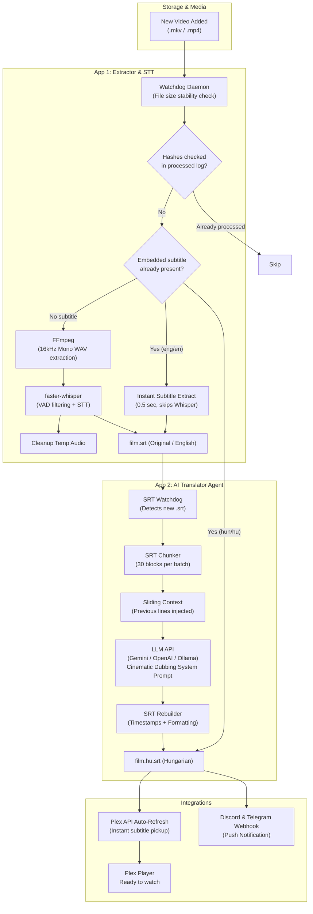

<div align="center">

# Plex AI Subtitler
### Automated Speech-to-Text and LLM Translation Pipeline for Plex Media Server

[](https://www.python.org/)
[](https://github.com/SYSTRAN/faster-whisper)
[](https://ai.google.dev/)
[](https://github.com/TomSchimansky/CustomTkinter)
[](#windows-system-tray)
[](#docker-and-nas-support)
[](https://www.plex.tv/)
[](LICENSE)
[](https://github.com/Gyuri125/plex-ai-subtitler)

<br />

**[Magyar nyelvű leírás](#magyar-dokumentacio-es-hasznalati-utmutato)** | **[Agent & Developer Guide](AGENT_README.md)**

<br />

<p align="center">
  <b>Plex AI Subtitler</b> is an automated pipeline that monitors media libraries, extracts embedded text subtitles in seconds (or transcribes audio using <code>faster-whisper</code>), translates subtitles into natural Hungarian using modern LLMs with sliding context, triggers instant Plex library refreshes, and sends push notifications.
</p>

</div>

---

## Key Highlights

<table>
  <tr>
    <td width="50%">
      <h3>Stage 1: Extraction, Online Fetch & Whisper STT</h3>
      <ul>
        <li><b>Embedded Subtitle Fast-Extraction:</b> Probes <code>.mkv</code> and <code>.mp4</code> containers for existing subtitles. If found, extracts them in under a second and bypasses Whisper entirely.</li>
        <li><b>Online Subtitle Downloader (OpenSubtitles):</b> Queries online repositories by 64-bit OSdb moviehash and clean title before Whisper. Downloads finished Hungarian or English subtitles instantly.</li>
        <li><b>Quality Gate & Hallucination Filter:</b> Removes Whisper phantom texts (e.g. <i>"Thank you for watching"</i>, <i>"Please subscribe"</i>) and fixes invalid or overlapping timestamps.</li>
        <li><b>Auto-Sync (ffsubsync):</b> Automatically aligns subtitle timing with speech in the video file for millisecond accuracy.</li>
        <li><b>Hardware Auto-Tuning:</b> Automatically inspects CUDA/VRAM and configures the optimal Whisper model.</li>
      </ul>
    </td>
    <td width="50%">
      <h3>Stage 2: AI Subtitle Translator</h3>
      <ul>
        <li><b>Sliding Context Window:</b> Injects the most recent translated lines into subsequent prompts, preserving continuous tone, gender, and pronoun consistency.</li>
        <li><b>Series Memory & Character Glossary:</b> Automatically creates and updates <code>series_context.json</code> across episodes to enforce consistent terminology and address forms.</li>
        <li><b>Parallel Worker Pipeline:</b> Concurrently processes chunk partitions across multiple threads, cutting total translation time in half.</li>
        <li><b>Multi-Provider:</b> Native support for Google Gemini (Flash / Pro), OpenAI (GPT-4o-mini), and local Ollama (Llama 3 / Mistral).</li>
        <li><b>Rate-Limit Protection:</b> Intelligent retry mechanism with exponential backoff and quota recovery.</li>
      </ul>
    </td>
  </tr>
  <tr>
    <td width="50%">
      <h3>Desktop GUI & Web Dashboard</h3>
      <ul>
        <li>CustomTkinter Dark Mode desktop interface.</li>
        <li><b>Built-in Web Dashboard:</b> Access, monitor, and configure the application from any web browser or mobile device on headless/NAS servers (port 8080).</li>
        <li><b>Windows System Tray:</b> Minimizes to the taskbar notification area and continues running in the background.</li>
        <li>Dynamic model discovery directly querying available Gemini, OpenAI, or Ollama models.</li>
      </ul>
    </td>
    <td width="50%">
      <h3>Integrations & Notifications</h3>
      <ul>
        <li><b>Plex Auto-Refresh:</b> Calls the Plex API (<code>/library/sections/all/refresh</code>) as soon as the subtitle is ready so it appears in the player immediately.</li>
        <li><b>Discord & Telegram Alerts:</b> Receive push notifications with translation duration and block statistics.</li>
        <li><b>Sidecar Naming:</b> Generates <code>movie.srt</code> and <code>movie.hu.srt</code> for 100% native Plex compatibility.</li>
      </ul>
    </td>
  </tr>
</table>

---

## Architecture Pipeline



---

## Plex File Naming Convention

Plex Media Server automatically indexes subtitles that follow standard sidecar naming conventions:

```text
/Media/Movies/
|-- Inception (2010).mkv
|-- Inception (2010).srt          <-- Stage 1 Output (English / Source)
`-- Inception (2010).hu.srt       <-- Stage 2 Output (Hungarian / AI Translated)
```

Both subtitles appear in the Plex player subtitle selector without requiring library re-scans.

---

## Hardware Auto-Tuning Matrix

The built-in `HardwareManager` scans system CUDA capabilities and configures `faster-whisper` for maximum throughput without Out-Of-Memory (OOM) errors:

| Hardware Tier | Detected Hardware | Recommended Model | Device | Compute Type | Transcription Speed |
| :--- | :--- | :--- | :--- | :--- | :--- |
| **High GPU** | NVIDIA CUDA >= 8GB VRAM | `large-v3` | `cuda` | `float16` | ~30x realtime |
| **Mid GPU** | NVIDIA CUDA >= 4GB VRAM | `medium` | `cuda` | `float16` | ~20x realtime |
| **Entry GPU** | NVIDIA CUDA < 4GB VRAM | `small` | `cuda` | `float16` | ~15x realtime |
| **CPU Only** | Multi-core CPU | `small` | `cpu` | `int8` | ~3-5x realtime |

---

## Installation & Quick Start

### 1. Prerequisites
- Python 3.11+
- FFmpeg (Windows: `winget install ffmpeg`, Linux: `sudo apt install ffmpeg`, macOS: `brew install ffmpeg`)
- Optional: NVIDIA GPU with CUDA drivers

### 2. Clone & Setup

```bash
git clone https://github.com/Gyuri125/plex-ai-subtitler.git
cd plex-ai-subtitler

python -m venv .venv

# Windows (PowerShell):
.venv\Scripts\Activate.ps1
# Windows (cmd):
.venv\Scripts\activate.bat
# Linux/macOS:
source .venv/bin/activate

pip install -r requirements.txt
```

### 3. Launching

- **Windows Shortcut:** Double-click `inditas.bat` to launch the GUI without an open console window.
- **Command Line:**
  ```bash
  python -m plex_subtitler.app1_extractor.main
  ```

---

## Standalone Executable Build & Auto-Updater

The repository includes a Windows build script: `build_exe.bat`.

Features:
1. Runs `git pull origin main` to pull latest updates from GitHub.
2. Updates dependencies and PyInstaller.
3. Closes running instances of `PlexSubtitler.exe` to avoid file locks.
4. Compiles the executable and updates `dist/PlexSubtitler/PlexSubtitler.exe`.
5. Prompts to launch the updated application immediately.

---

## Docker and NAS Support

Run headless on home servers or NAS devices (Unraid, TrueNAS, Synology) via `docker-compose`:

```bash
docker-compose up -d
```

Example `docker-compose.yml`:
```yaml
version: "3.8"
services:
  plex-subtitler:
    build: .
    container_name: plex-ai-subtitler
    restart: unless-stopped
    volumes:
      - /path/to/media:/media:rw
      - ./settings.json:/app/plex_subtitler/settings.json:rw
      - ./processed_files.log:/app/plex_subtitler/processed_files.log:rw
```

---

## Supported LLM Providers

| Provider | Recommended Model | Speed | Cost | Notes |
| :--- | :--- | :--- | :--- | :--- |
| **Google Gemini** | `gemini-1.5-flash` / `gemini-2.0-flash` | Ultra-Fast | Free tier / Very low cost | High context quality, high rate limits. |
| **OpenAI** | `gpt-4o-mini` | Very Fast | Low | High translation fidelity and consistency. |
| **Ollama (Local)** | `llama3:8b`, `mistral`, `qwen2.5` | Fast (GPU) | 100% Free | Fully offline on local hardware. |

---

## Magyar Dokumentacio es Hasznalati Utmutato

### A rendszer fo komponensei:
1. **Beagyazott feliratok gyorskinyerese (100x gyorsulas):**
   Ha az `.mkv` vagy `.mp4` videoban mar talalhato angol vagy magyar felirat, a program 0.5 masodperc alatt kinyeri, igy a gep terhelese es a feldolgozasi ido minimalisra csokken.
2. **Online feliratletoltes (OpenSubtitles):**
   A videofajl 64-bites hash-e alapjan ellenorzi a netes adatbazisokat. Ha talal kesz magyar feliratot, a forditas is kihagyhato; ha angolt talal, a Whisper lepes ugorhato at.
3. **Quality Gate es Whisper hallucinacio-szures:**
   Kiszuri az ismert fantomszovegeket (*"Thank you for watching"*, *"Please subscribe"*, zenei szimbolumok), javitja az atfedo idobelyegeket, es ellenorzi, hogy egyetlen sor sem veszett el a forditas soran.
4. **Auto-Sync idozites-szinkronizalas (`ffsubsync`):**
   A felirat idobelyegeit a video valodi hangsavjahoz igazitja millimasodperc pontosan.
5. **Gordulo kontextus-ablak (Sliding Context):**
   A blokkok elott atadja az elozo jelenet utolso sorait, biztositva a szinkron-stilusos tegezes/onozes es a karakterek nemenek folytonossagat.
6. **Sorozat-memoria es karakter-szotar (`series_context.json`):**
   Sorozatoknal automatikusan rogziti es fejbantartja a foszereplok viszonyat es a visszatero szakkifejezeseket, igy az egesz evad nyelvezete egyseges marad.
7. **Parhuzamositott forditas (Pipeline Throughput):**
   Tobbszalu concorrent LLM keresekkel felezi vagy harmadolja a forditas idotartamat.
8. **Beepitett Web Dashboard (Headless es NAS szerverekhez):**
   Monitor nelkuli szervereken vagy NAS eszkozokon (port 8080) keresztul bongeszobol es mobilrol is kovetheto az allapot, a naplo es a beallitasok.
9. **Plex konyvtarfrissites es Push ertesitesek:**
   Azonnali frissites a Plex API-n keresztul, valamint Discord es Telegram uzenetek.
10. **Rendszertalca (System Tray) es Automata build script (`build_exe.bat`):**
    Talcara rejtes es egykattintasos PyInstaller fordito.

---

## License

Distributed under the MIT License. See [LICENSE](LICENSE) for details.
